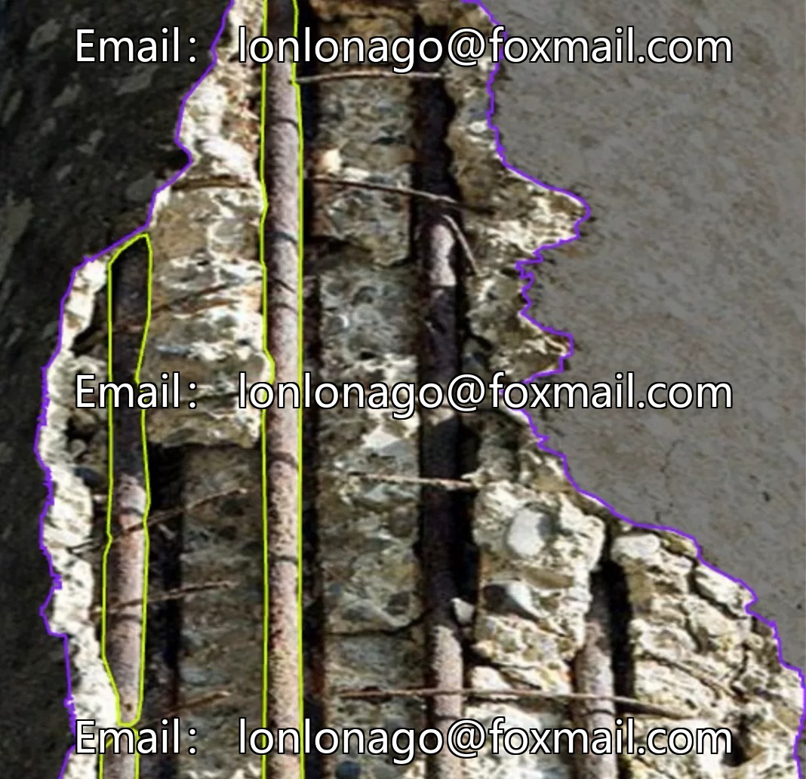
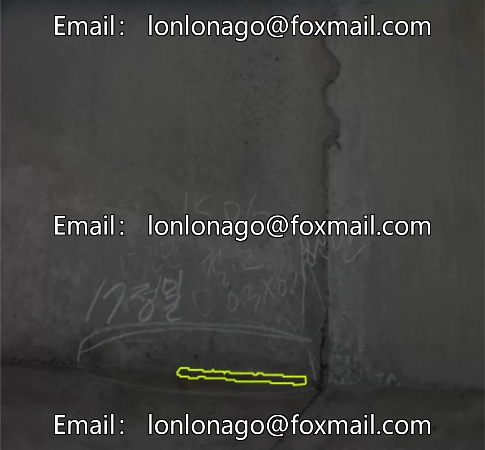
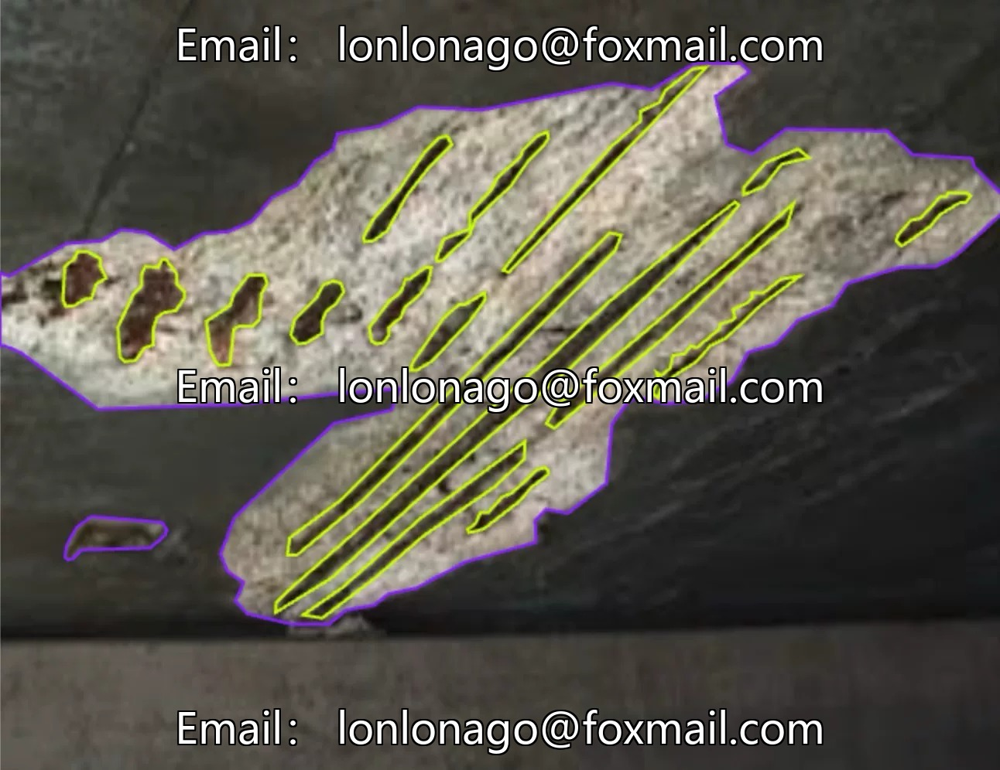
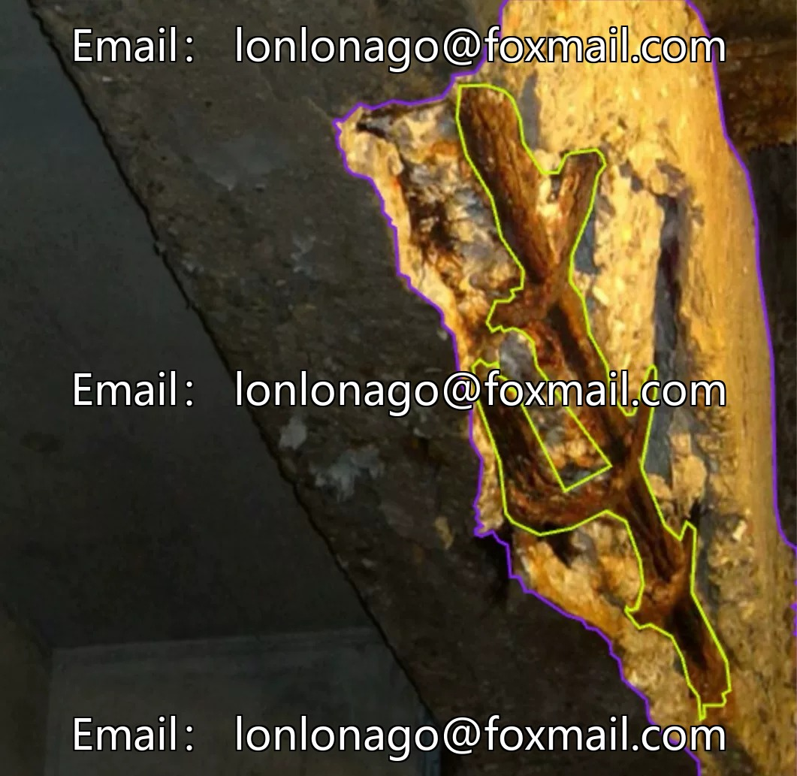
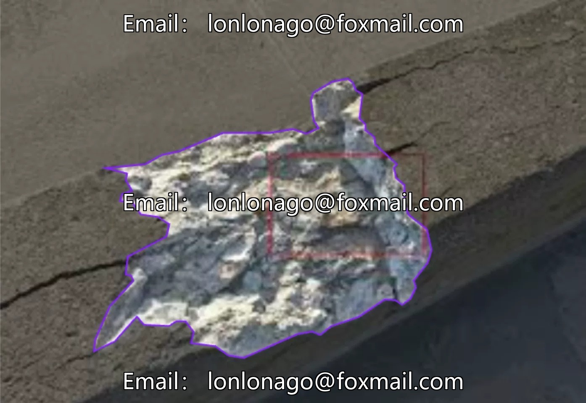

# Smart construction site wall defect identification dataset, 1200 images, including exposed rebar (e).

## Body

Intelligent Construction Site Wall Defect Identification Dataset, 1200 images, including two categories: exposed rebar (exposed_rebar) and wall spalling (spalling), suitable for training instance segmentation models. The format is mainstream, directly usable without conversion.

The dataset focuses on the detection of architectural structural defects, supporting automated inspections to enhance inspection efficiency. Complementary 2 files, complete sample system, suitable for training of small and medium-sized models.

Virtual materials, once sold, are non-refundable.
Interested friends, click "I want" to proceed.

## Images

## Payment

Here is a pay link on Stripe ( https://buy.stripe.com/3cs8yP7sY87d0vu9AB ). Please contact me lonlonago@foxmail.com after funding $89, and I will send you a complete data files , thank you!

